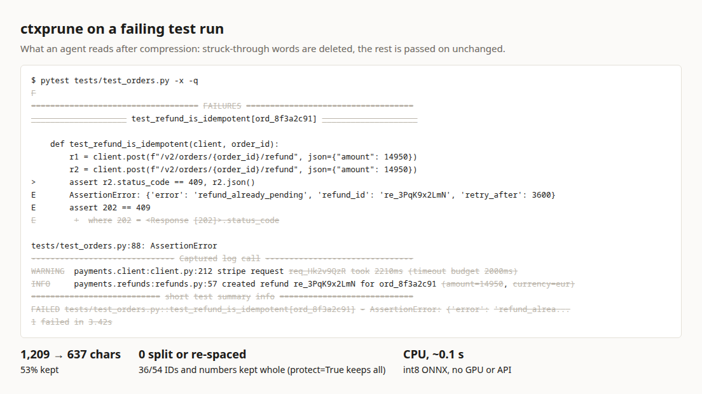

# ctxprune

Shrink what your LLM reads, locally. ctxprune has two parts:

| you want to... | use | drops content? | what you get |
|---|---|---|---|
| shrink tool outputs inside a coding agent (Claude Code, Hermes, Pi, OpenCode, dsh, Codex) | `ctxprune install --all` | **no**: every value stays | ~9% fewer tool-output tokens on MCP-heavy work (12% on Claude Opus), 0.3–4% on coding |
| shrink prompts, retrieved documents or logs you control (Python, LangChain, LlamaIndex, shell) | `ctxprune.prune(text, keep=0.5)` | **yes**: deletes low-value words | you pick the size; at 50% kept, +15 points of QA accuracy over LLMLingua-2-large |

Both run on your machine with no API key, and nothing leaves it.

## What it's good for

- **MCP-heavy agents** (Linear, Notion, GitHub, databases, Playwright): JSON record lists become rows and
  Playwright snapshots lose their YAML noise. This is where the agent hooks save the most: 8.7% of tool-output
  tokens on an MCP-heavy mix, 12.0% on Claude Opus.
- **Claude Code on Windows**: PowerShell output loses its colour codes, saving 4.1% of tool-output tokens (6.5% on
  Opus) in real sessions.
- **Long Claude Opus sessions**: cross-turn dedup turns a repeat of an output that is still in context into a
  reference. Opus reads those references as well as the originals (−0.2 points [−1.8, +1.3]). Open models don't,
  so dedup is on for Opus only.
- **Agents that must not lose a detail**: unlike lossy compactors, the `safe` preset never drops content, leaves file
  views and code the agent may edit alone, and caused no re-fetches in next-action replay.
- **RAG and prompt pipelines**: `CtxpruneDocumentCompressor` (LangChain) and `CtxpruneNodePostprocessor`
  (LlamaIndex) cut retrieved documents to a set share of tokens and keep IDs, paths and numbers unsplit.
- **Logs and CI output before you paste them into a chat**: `some_command | ctxprune --keep 0.33 --protect`.

Not for: shrinking source files you'll edit (left alone by design), or coding sessions that are mostly file reads
(Claude Code's `Read` is 58% of tool tokens in the sessions measured, and the hooks don't touch it, which is why the
coding number is small).

**What the agent hook does to one MCP result** (a Linear `list_issues` reply, 521 → 285 o200k tokens; produced by
`ctxprune compress`):

```
[cp:rows #1 TSV id, title, state, assignee(json), labels(json), updated_at; compact]
PRJ-140	Checkout times out on slow 3G	open	{"login":"mila"}	[{"name":"bug"}]	2026-11-10T09:00:00Z
PRJ-141	Add Dutch translations for invoices	open	{"login":"joost"}	[{"name":"i18n"}]	2026-11-11T09:07:00Z
...
```

Every key and value is still there: decoding gives JSON equal to the original (only the pretty-print whitespace
isn't restored). Rules that are byte-exact are checked against the original on every output and skipped if the
check fails. [What is exact and what isn't](#what-is-exact-and-what-isnt) has the details per rule.

## Numbers at a glance

| | result | source |
|---|---|---|
| tool-output tokens saved, `safe`, MCP-heavy mix | **8.7%** [8.2, 9.3]; **12.0%** on Opus | 2,225 public agent trajectories, o200k |
| ... coder plus MCP mix | 3.7% [3.0, 4.6]; 7.6% on Opus | same |
| ... real Claude Code sessions, Linux/macOS | 0.3% [0.0, 0.6]; 1.8% on Opus | 37 sessions |
| ... real Claude Code sessions, Windows | 4.1% [2.0, 6.9]; 6.5% on Opus | 18 sessions |
| exactness checks on changed outputs | **0 failures**: 1,205 byte-exact, 5,463 JSON-equal | same traces |
| next-action replay (does the agent do something different?) | `safe`: 0 re-fetches (it changed 7 of 400 items); other compactors at their defaults: +13 to +45 points of changed next actions | 400 items, Qwen3.6 + Qwen3.8 ([BENCHMARKS §8](https://github.com/riceharvest/ctxprune/blob/main/docs/BENCHMARKS.md#8-compared-with-other-compactors)) |
| reading accuracy, Claude Opus 5.5 | `jsonrows`, `a11y` and 4 opt-in rules: −3 to +1 points vs the raw output; dedup −0.2 [−1.8, +1.3] | 100 questions per rule, 450 for dedup |
| hook latency (Claude Code, fresh process per call) | p50 39 ms, p95 47 ms (runtime 106bcea) | 300 replayed events |
| token pruning, QA at 50% kept (uncompressed 91.8%) | **68.8%** vs LLMLingua-2-large 53.4%, -base 41.0% | 378 held-out questions, DeepSeek V4 Flash reader |

Brackets are 95% CIs. The agent-hook numbers trace back to scripts and result files in
[docs/BENCHMARKS.md](https://github.com/riceharvest/ctxprune/blob/main/docs/BENCHMARKS.md), and the token-pruning ones to the
[model card](https://huggingface.co/darioooooo0o/ctxprune-small).
The savings are small on purpose: lossy tools save more (LLMLingua-2 and headroom remove 18–58% at their defaults)
but change what the agent does next. `ctxprune stats` shows what it saves on your own machine.

The hooks and plugins use only the Python standard library, with no model, no network and no server. Their output is
byte-identical across operating systems and Python versions, and they never re-render history that a model has
already cached.

## Install

```sh
uv tool install ctxprune        # or: pipx install ctxprune
ctxprune install --all          # every supported agent found on this machine
ctxprune doctor                 # checks versions and runs a test call through each integration
```

To install for one agent only: `ctxprune install claude-code` (or `hermes`, `pi`, `opencode`, `dsh`, `codex`).
`ctxprune uninstall --all` removes everything it added. The first time `install` changes one of your config files,
it keeps a backup of the original. [PACKAGE.md](https://github.com/riceharvest/ctxprune/blob/main/PACKAGE.md) lists every file it touches, the paths it uses, and notes
for Windows and for the Codex proxy.

Don't run `install` through `uvx`. It writes the interpreter path into your agent configs, and uvx deletes that
environment later. `ctxprune install` refuses to run from one.

**Claude Code plugin, without pip.** A self-contained plugin bundles the same stdlib runtime, so it needs only
Python 3.9+ on the machine:

```
/plugin marketplace add riceharvest/ctxprune
/plugin install ctxprune-safe@ctxprune
```

Use either the plugin or `ctxprune install claude-code`, not both. `ctxprune doctor` warns if both are on.

## Token pruning: the 0.2 API (Python, LangChain, LlamaIndex)

This is lossy compression for prompts, retrieved documents and logs: a 140M-parameter token classifier
([darioooooo0o/ctxprune-small](https://huggingface.co/darioooooo0o/ctxprune-small), Apache-2.0) deletes the words that
matter least and keeps identifiers, paths and numbers unsplit. It runs on CPU (int8 ONNX, ~0.1 s per 500 tokens;
the model downloads once, 143 MB). It works exactly as in 0.2.1, with the same outputs byte for byte. The agent hooks
above never use it.



```sh
pip install ctxprune               # library + CLI; the model downloads on first use
```

```python
import ctxprune
short = ctxprune.prune(text, keep=0.5)                # keep ~50% of the tokens
short = ctxprune.prune(text, keep=0.33, protect=True)  # never drop identifiers, numbers or paths

from ctxprune import Compressor                        # batching, fp32, torch backend, keep_structure
Compressor().compress(text, rate=0.5)["text"]
```

```python
from ctxprune.integrations import CtxpruneDocumentCompressor   # LangChain (pip install "ctxprune[langchain]")
retriever = ContextualCompressionRetriever(base_compressor=CtxpruneDocumentCompressor(rate=0.5),
                                           base_retriever=base)

from ctxprune.integrations import CtxpruneNodePostprocessor    # LlamaIndex (pip install "ctxprune[llamaindex]")
engine = index.as_query_engine(node_postprocessors=[CtxpruneNodePostprocessor(rate=0.5)])
```

```sh
ctxprune build.log --keep 0.5                  # or: some_command | ctxprune --keep 0.33 --protect --stats
ctxprune serve                                 # HTTP on 127.0.0.1:8719: POST /compress {"text": ..., "rate": 0.5}
```

With LLMLingua: `PromptCompressor(model_name="darioooooo0o/ctxprune-small", use_llmlingua2=True)` needs
[LLMLingua#261](https://github.com/microsoft/LLMLingua/pull/261).

How good it is: at 50% of tokens kept, a reader LLM (DeepSeek V4 Flash) answered 68.8% of 378 held-out questions on
agent text exactly, vs 53.4% for LLMLingua-2-large and 41.0% for LLMLingua-2-base (uncompressed: 91.8%). It is weaker
than LLMLingua-2-large on non-English web prose, and the question set comes from our own training sources. Per-source
tables and caveats are on the [model card](https://huggingface.co/darioooooo0o/ctxprune-small). The training and
evaluation code for this model is at tag [`v0.2.1`](https://github.com/riceharvest/ctxprune/tree/v0.2.1)
(`scripts/`, `ctxprune/`).

## What is exact and what isn't

"Lossless" means different things for different rules, so here is the precise version.

**Byte-exact.** The decoder (`lossless.decode`) returns the original bytes. Each rule is checked against the original
on every output, and it is dropped for that output if the check fails.
On by default:
- `table`: an aligned table (`ps`, `docker ps`, `kubectl get`) is single-spaced. The columns are restored on decode.
- `diffhdr`: `---`/`+++` lines that repeat the `diff --git` line are dropped.
- `jsonrows`: a JSON array of 3 or more records with nested objects or arrays in them (typical MCP results) is
  written as tab-separated rows under one header. The rewrite is used only if the exact original bytes (key order,
  numbers, spacing) come back. Off for local / self-hosted endpoints (see "Presets").
- `json_ascii`: JSON where non-ASCII text is `\uXXXX`-escaped is shown with the characters themselves, under one
  header line. The decoder restores the exact escapes, including hex case.
- Windows text: a leading BOM is set aside and put back. CRLF line endings are kept exact line by line.
- `a11y`: Playwright MCP accessibility snapshots drop the YAML `- ` dash, and ` [cursor=pointer]` becomes ` ↗`.
  Element refs stay byte-exact.
- Marker escaping (see [docs/SAFETY.md](https://github.com/riceharvest/ctxprune/blob/main/docs/SAFETY.md)).

Opt-in (off by default). With the output placed inside a 16k–56k-token agent transcript, a reader did worse on these,
even though short 1–6k-token probes showed no loss (see "Which models it was tested on"). Each saved under 1% of
tokens:
- `CTXPRUNE_HITS=1`: grep-style `path:line:text` runs become a `path` header plus `line:text` lines. At long context
  the reader filed hits under the wrong file header.
- `CTXPRUNE_PATHS=1` (or `CTXPRUNE_PATHS_MODELS=<hosted model ids>`): runs of bare `/` paths in one directory are
  grouped under that directory; Hermes `search_files` file lists become one path per line (`sffiles`). Files ended up
  under the wrong directory header. Windows `\` path lists stay raw even when it is on.
- `CTXPRUNE_NUMBERED=1`: a padded line-number gutter (`cat -n`, `nl`) is unpadded. The reader re-ran the view more
  often instead of answering.
- `CTXPRUNE_JSONROWS_FLAT=1`: `jsonrows` also on flat records (search hits, a git log as JSON). The reader re-ran the
  search instead of answering (re-fetch +7 points).

**Exact content, but no decoder.** Three or more identical consecutive lines become one line plus `[× N]`. The count
is exact, but `lossless.decode` doesn't expand it, so I don't count it as byte-exact.

**Render-preserving, not byte-exact.**
- **ANSI:** colour and title codes (SGR/OSC) are removed. Cursor moves and erases are kept. This never runs on file
  views.
- **CR:** progress-bar redraws that use `\r` are collapsed to the final state the terminal would show.

**Value-preserving, not byte-exact.** These need a JSON parser to see that nothing changed.
- **`json_compact`:** removes the whitespace between JSON tokens of pretty-printed JSON. Every key and value parses
  identically.
- **`json_unescape`:** a JSON wrapper around a text field (e.g. `{"output": "...", "exit_code": 0}`) becomes one header
  line with the other keys, followed by the text unescaped. The text is exact.

**Never touched.** File views (`Read`, `cat`, `sed -n`, `git show`/`diff`/`blame` and the like) get no rule by
default (only the opt-in `numbered`), so code lines that an agent copies into an edit stay byte-identical. Edit/Write results are not changed.

On the public traces below, the per-output checks found 0 failures:
- 1,205 changed outputs were decoded byte-exact;
- 5,463 were checked for identical JSON values;
- with dedup on, 2,960 outputs were checked byte-exact, the deduped ones through `dedup.expand`.

1,254 outputs carry a combination the check script doesn't verify end to end, mostly `json_compact` followed by
`jsonrows`. 194 had ANSI codes removed.

## How much it saves

These figures are % of the tool-output tokens the model sees, measured with o200k on 2,225 public agent
trajectories (28,174 tool outputs). They use the `safe` preset at the 0.3.0 runtime, run through each integration's
real reach: in Claude Code that is Bash, PowerShell, Grep and MCP tools, not Read. Brackets are 95% trajectory
bootstrap CIs.

The two columns differ only in cross-turn dedup:
- **On Claude Opus** (`claude-opus-*` served by Anthropic), dedup is on: a repeat of something still in context
  becomes a reference to it.
- **Every other model** has dedup off.

| who | any other model | on Claude Opus (dedup on) |
|---|--:|--:|
| Claude Code coder, sessions with no PowerShell call (37: 28 Terminal-Bench trials, 9 trace-commons) | **0.29%** [0.04, 0.62] | **1.76%** [0.66, 3.38] |
| Claude Code coder, Windows sessions (18 with PowerShell calls, all trace-commons) | 4.08% [1.98, 6.88] | 6.53% [4.23, 9.86] |
| Mix 1, coder with few MCP servers (coding 0.8, GitHub MCP 0.1, web search 0.1) | 2.64% [1.47, 4.08] | 4.58% [3.02, 6.13] |
| Mix 2, coder plus MCP (coding 0.5, browser 0.2, GitHub 0.15, DB 0.05, web 0.1) | 3.69% [2.95, 4.59] | 7.55% [6.56, 8.58] |
| Mix 3, MCP-heavy assistant (multi-server MCP 0.3, Notion 0.15, browser 0.2, web 0.15, API tools 0.2) | **8.73%** [8.16, 9.28] | **12.04%** [11.42, 12.60] |

How to read this:
- **The traces don't say which model wrote them.** The Opus column is what dedup removes from these same sessions. I
  measured how well Opus reads the references separately (below).
- **The weights in mixes 1–3 are my assumptions,** not measured user mixes. "Coding" in the mixes means the 55 real
  Claude Code sessions, Windows and non-Windows pooled. The Windows sessions hold 68% of those tokens, so mixes 1 and 2
  mostly reflect Windows. On Linux or macOS, the first row is the closer guide.
- **Most of the Windows gain is removing ANSI colour codes** from PowerShell output. That is a render-preserving rule,
  not a byte-exact one.
- **Claude Code's biggest tool is Read** (58% of tool tokens in these 55 sessions). ctxprune leaves Read alone by
  design, which is why the coding number is small.
- **MCP JSON is where the structural rules pay off,** mostly through `jsonrows` and `json_compact`.
- **Grep grouping, `paths`, `numbered` and flat-record `jsonrows` are opt-in** since the long-context probe; on Linux
  Claude Code sessions they were most of what the default saved without dedup (0.98% before, 0.29% now).
- **Other tokenizers:** with Qwen3.6, the mixes are 2.38 / 3.36 / 9.05% (dedup off) and 4.11 / 7.14 / 12.43% (dedup
  on), with no CIs. I didn't count with Claude's tokenizer; o200k and Qwen3.6 stand in for it.

**Big outputs Claude Code saves to a file** (Bash over 30k chars, MCP over 50k chars or over its token cap) are not in
the table above, because the model only sees a preview of them. For these, ctxprune rewrites the file itself
losslessly ("spill files", on by default). If the agent later reads a quarter of such a file, this adds
+0.05 / +0.58 / +0.67 points to mixes 1 / 2 / 3. How much of the file gets read back is an assumption; I couldn't
measure it.

Every number, the exact commands and the scripts are in [docs/BENCHMARKS.md](https://github.com/riceharvest/ctxprune/blob/main/docs/BENCHMARKS.md). `ctxprune stats`
shows what it saved on your own machine (a counts-only log; see "Privacy").

## Which models it was tested on

I checked that models still read the rewritten output correctly. Each rule got 100–150 questions, asked once on the
raw output and once on the rewritten one, and accuracy was compared with a paired bootstrap.

**Claude Opus 5.5** (through `claude -p`, n = 100 per rule, short outputs only) passed every rule it was given:
- `hits`, `paths`, `numbered`, flat `jsonrows` and Playwright `a11y` all scored 0.0 to +1.0 points.
- `jsonrows` on MCP results scored −2.0 [−5.0, 0.0], and −3.0 [−7.0, 0.0] with the marker note. The CIs touch 0,
  and graded on the answer's last line it was 100 → 100.

Opus also passed cross-turn dedup in the shipped format: −0.2 [−1.8, +1.3] over 450 multi-turn items.

**Open models: Qwen3.8-27B, Qwen3.6-35B-A3B and Gemma 4 31B** (with thinking on and off, n = 100–150 per rule):
- **The same default rules:** within ±2 points.
- **`json_ascii`:** it *improved* accuracy by +11 to +20 points on both Qwen readers in every mode. Raw `\uXXXX`
  escapes were read correctly only 54–60% of the time.
- **Cross-turn dedup:** they failed it. Qwen3.8 lost 7.3 points on whole-output references, 18 on line runs and 21 on
  references to tool inputs. That's why dedup is on for Opus only.

**Long context (Qwen3.6-35B-A3B, the shipped bytes).** Short probes put one output in a 1–6k-token prompt. Real
sessions are 50k+ tokens, so each output was also placed at 10/50/90% depth of a 16k/32k/56k-token agent transcript
(every other output encoded too, tool schemas sent; 24 items × 9 cells per rule). A reply that re-runs a tool instead
of answering was counted as a re-fetch (an extra turn), not as wrong. Without thinking:
- `json_ascii` +27.3 [+11.1, +44.0] points, nested-record `jsonrows` +1.4, Playwright `a11y` +4.6: kept on.
- grep grouping −3.7 [−9.7, +3.2] (hits filed under the wrong file), `paths` −8.3 [−20.9, −0.5] (an earlier run),
  flat `jsonrows` re-fetch +7.4 [+3.7, +12.0], `numbered` re-fetch +5.1 [+0.9, +10.2]: made opt-in.
- With thinking: `json_ascii` +26.4, flat `jsonrows` re-fetch +12.0 [+5.6, +18.1]; grep grouping *helped*
  (+8.3, fewer re-greps), but it had to pass in both modes, so it is opt-in.
- Claude has no long-context data; the rules above are off for it too.

**Not probed:**
- other Claude models (Sonnet, Haiku) and other hosted models: they get dedup off;
- `table`, `diffhdr` and `sffiles` on Claude (on the open readers they scored 0 to +2 points, `sffiles` −1 in two modes);
- the `[× N]` repeat counts, and the JSON compaction and unescape steps;
- `json_ascii` on Claude and Gemma.

## Presets

- **`safe` (the default).** The rules above, with nothing dropped and no model.
  - **Cross-turn dedup is decided by model**, once per session. It is on for `claude-opus-*` served by Anthropic and
    off for everything else (`ctxprune_core.DEDUP_MODELS`). `CTXPRUNE_DEDUP=0|1` overrides that in every integration.
  - In Claude Code the hook reads the model from the session. If `ANTHROPIC_BASE_URL` points anywhere other than
    Anthropic, dedup stays off.
  - **Grep grouping, `paths` (with `sffiles`), `numbered` and flat-record `jsonrows` are opt-in for every model**
    (the long-context results above). No model has long-context data for them yet, Claude included, and a Claude
    Code session is past 16k tokens before its first tool output. On public Linux Claude Code sessions they were most
    of the default's saving without dedup (0.98% of tool tokens before, 0.29% now); on assistant / multi-MCP workloads
    0.6–0.8%.
  - **On a local or self-hosted endpoint `jsonrows` is off.** On nested MCP records, local thinking models spent +139
    to +407 extra thinking tokens per lookup to save ~176 prompt tokens, a latency loss on your own GPU.
  - To opt in to `paths`: `CTXPRUNE_PATHS_MODELS=claude-` (a comma list of hosted model ids; entries ending in `-` are
    prefixes; local and self-hosted endpoints stay off), or `CTXPRUNE_PATHS=1` (every target). `CTXPRUNE_PATHS=0`
    forces it off.
- **`balanced` and `aggressive` (opt-in, experimental).** These also drop low-value lines with a small line-scoring
  model, keep a recovery file for every dropped range, and leave file views whole.
  - They need `pip install "ctxprune[model]"` and `ctxprune serve --model-dir DIR`.
  - The 0.3.0 model weights are not published yet, so for now these presets are for experiments.
  - In my session runs, the cost results were mixed (see "Presets" in [docs/BENCHMARKS.md](https://github.com/riceharvest/ctxprune/blob/main/docs/BENCHMARKS.md)).
- **Harnesses that opt out of lossy.** On **Codex, dsh, OpenCode and Pi**, `balanced` runs as `safe` unless you set
  `CTXPRUNE_FORCE_LOSSY=1`.
  - Codex cost +36.8% (90% CI +15.8 to +60.6) with the model on: holes in file views made it re-read ranges in
    loops.
  - dsh used 14% more prompt tokens and 1.9 more turns per episode.
  - Pi and OpenCode didn't lower cost reliably.
  - `aggressive` applies everywhere, because choosing it is an explicit opt-in.

Pick a preset with `ctxprune install --all --preset balanced`, or set `CTXPRUNE_PRESET`.

## Opt-in rules

These rules are off by default. In the comprehension probes on open models each one cost accuracy or extra
thinking, so you should only turn one on if you've checked it with your model. Only the first four were probed on
Claude (short outputs, where they passed); the long-context results that turned them off are from Qwen3.6.

| flag | what it does | why it's off |
|---|---|---|
| `CTXPRUNE_HITS=1` | Grep-style `path:line:text` runs become a `path` header plus `line:text` lines. | Without thinking at 16k–56k context: −3.7 [−9.7, +3.2] points, hits filed under the wrong file (with thinking +8.3). On real Claude Code sessions it was the biggest default saver: about 0.7–0.8 of the 1.4% of hook-reachable tokens on the author's sessions. |
| `CTXPRUNE_PATHS=1` | Runs of bare `/` paths are grouped under their directory; Hermes `search_files` lists become one path per line. `CTXPRUNE_PATHS_MODELS=<ids>` limits it to listed hosted models. | At 16k–56k context: −8.3 [−20.9, −0.5] points, −11 at 56k (wrong directory). Saves 0.1–0.6% (0.13 of 1.4% reachable on the author's Claude Code sessions). |
| `CTXPRUNE_JSONROWS_FLAT=1` | `jsonrows` also on flat records (search hits, a git log as JSON). | At 16k–56k context the reader re-ran the search instead of answering: +7.4 [+3.7, +12.0] points of re-fetches. Saves up to 0.75%. |
| `CTXPRUNE_NUMBERED=1` | A padded line-number gutter (`cat -n`, `nl`) is unpadded. | At 16k–56k context, without thinking: +5.1 [+0.9, +10.2] points of re-fetches. Saves 0.27 of 1.4% reachable on the author's Claude Code sessions. |
| `CTXPRUNE_BLOCKREF=1` | A repeated run of lines inside one output becomes `[cp:= same as lines A–B]`. | It lost 27–85 points overall (3 on Qwen3.8 with the marker note) and 73–100 on "how many times" questions. |
| `CTXPRUNE_PREFIX=1` | Lines that share a prefix (e.g. `web-1  \| ` in `docker compose logs`) are written once. | Without thinking it cost 2.7–6.7 points. With thinking it used ~2.9× the thinking tokens. |
| `CTXPRUNE_JSONROWS_EXT=1` | `jsonrows` also flattens sub-objects into `key.sub` columns and allows quoted keys. | Qwen3.6 with thinking: −7.3 points on those items. |
| `CTXPRUNE_READ_TRIM=1` | Claude Code `Read`: an already-shown, unchanged prefix or suffix of the file is dropped, and the line numbers stay exact. | It saved 1.14% [0.33, 2.34] of tool tokens on real sessions, but in 1.85% of Edits it would have hidden the latest copy of the text being edited. The A/B on Edit failures hasn't run yet. **The installer's hook matcher doesn't include `Read`**, so you also have to add `Read` to ctxprune's matcher in `~/.claude/settings.json` yourself, and again after every `ctxprune install` or `upgrade`, which rewrite that entry. |

`CTXPRUNE_SPILL=0` turns off the spill-file rewrite.

## Turning it off

- **Kill switch:** set `CTXPRUNE_OFF=1` in the agent's environment, or put it inside one command
  (`CTXPRUNE_OFF=1 cat big.log`). The output then passes through untouched.
- **The Codex proxy** also checks per request for the file `~/.cache/ctxprune/OFF`, so you don't need to restart it.
  The native hooks read only the environment variable.
- **Uninstall:** `ctxprune uninstall --all` removes everything that `install` added.

Every native integration fails open. If ctxprune crashes, hangs past its timeout, or can't import, the agent gets
the original output:
- the Claude Code hook has a 30 s timeout;
- the Pi, OpenCode and dsh plugins have a 60 s timeout;
- the in-process Hermes plugin gives up after `CTXPRUNE_BUDGET` seconds (2 by default).

The exception is the Codex proxy. It sits in the request path, so if the proxy process dies, Codex requests fail.

For the proxy and the plugins' request-time dedup, OFF is soft. New results go out raw, and results already sent keep
their bytes, so turning it on or off costs no prompt-cache miss.

Details are in [docs/SAFETY.md](https://github.com/riceharvest/ctxprune/blob/main/docs/SAFETY.md).

## Same bytes everywhere, and no re-rendered history

A prompt cache only helps if the bytes don't change, so ctxprune is built to keep them stable.

**Deterministic.** The same tool output gives the same bytes on every OS, Python version and locale.
- CI compared Windows, macOS and Ubuntu on Python 3.9–3.13: all 15 cells were identical.
- A local audit covered 9,935 output hashes across Python 3.9–3.14, hash seeds and non-UTF-8 locales, with 0
  differences.

**History stays put.**
- Hooks and per-output plugins only ever touch new tool results.
- The proxy and the plugins' request-time dedup pin the exact text they first sent for each result. An upgrade, or a
  preset, dedup or paths change, therefore reaches only new outputs, never history that's already cached.
- Request-time dedup only rewrites results that arrive after the last assistant turn it has seen, so turning it on
  mid-conversation leaves the earlier history alone. `CTXPRUNE_RERENDER` is ignored: a re-render is a history edit.
- The remaining one-time cache miss is a hard OFF (`echo hard > ~/.cache/ctxprune/OFF`).

Details are in [docs/SAFETY.md](https://github.com/riceharvest/ctxprune/blob/main/docs/SAFETY.md#6-determinism-and-prompt-cache).

## See what it saves: `stats` and `audit`

`ctxprune stats` reads the counts-only log that every integration writes and prints tokens saved, one row per
agent plus a total. Where the agent keeps its own usage records locally, it also prints ctxprune's **share of
input**: of the input that would have entered the context in that period (fresh input plus cache writes, not cache
reads), the part ctxprune removed. Content re-read from the prompt cache on later turns shrinks by about the same
share. The records it reads, read-only and numbers only (`--no-transcripts` skips them):

| agent | records | counted as |
|---|---|---|
| Claude Code | `~/.claude/projects/**/*.jsonl` | `usage` per API response: input + cache writes |
| Codex | `~/.codex/sessions/**/rollout-*.jsonl` | `token_count` events: input minus cached input |
| Pi | `~/.pi/agent/sessions/**/*.jsonl` | assistant `usage`: input (without cache) + cache writes |
| OpenCode | `~/.local/share/opencode/opencode.db` (read-only) | assistant `tokens`: input + cache writes |
| Hermes | `~/.hermes/sessions/session_*.json` only | these files hold no token counts: characters of the system prompt, tool schemas and messages |
| dsh | none | no verified local format; the counts log only |

`ctxprune audit` looks at the rest of the bill, which ctxprune doesn't touch, for every agent it finds.
- **Claude Code:** it reads your transcripts (`~/.claude/projects`) and settings, rebuilds each request's context,
  and prints where the bill goes: system prompt and tool schemas, MCP listings per server, skills and plugins,
  CLAUDE.md, hook injections, thinking and tool calls re-read on later turns, and tool results. Then it lists
  concrete things to remove, with what each costs: MCP servers you never call, plugins whose skills never ran,
  oversized CLAUDE.md files.
- **Codex, Pi, OpenCode, Hermes, dsh:** the static-overhead checks that apply to each: the prefix every session
  starts with (measured from the agent's records), instruction files (AGENTS.md, CLAUDE.md, HERMES.md, SOUL.md) and
  their size, configured MCP servers and how often their tools were called, skills and plugins, the measured
  prompt-cache share, and what each provider documents about caching (OpenAI, for example, caches prefixes
  automatically from 1,024 tokens, so a stable prefix matters).
- Every finding is marked **[verified]** (measured from your records, or checked by ctxprune on a stub API) or
  **[unverified]** (from the agent's or provider's documentation). Only verified savings go into totals.
- It is local and advice-only. It prints numbers and names (server, plugin and file names), never text from a
  prompt, an output or a file, disables network access for the run, and never changes a config file.

**Subscription or API.**
- **On the API**, both commands' dollar figures are what the tokens cost. `stats` uses `--price` (your model's
  input price per million tokens). `audit` prices every request at Claude Opus 5.5 list prices, by cache position.
- **On a subscription** (Pro or Max) nothing is billed per token, so the dollar figures are only a yardstick. A
  share of input tokens saved shows up as usage-limit headroom on the input side instead. Usage limits also count
  output, and they aren't published as token numbers, so it is an estimate of headroom, not a promise of more
  messages.
- Expect a small number either way. On my own Claude Code sessions tool results were about a fifth to a third of
  the bill, and the `safe` preset removed under 1% of the whole bill. The static context the audit points at (MCP
  listings, skills, CLAUDE.md, hook injections) was several times larger than that.

`ctxprune install claude-code --weekly-summary` (off by default) adds a SessionStart hook that shows you one line
with the last week's savings, at most once a week. Claude Code shows it in the terminal as a system message; it is
not sent to the model, so it adds no tokens. `--no-weekly-summary` removes it.

## Privacy

Nothing leaves your machine. ctxprune makes no network calls in the `safe` preset. What it stores locally:

| what | where (Linux/macOS) | contents | kept |
|---|---|---|---|
| stats log | `~/.local/state/ctxprune/stats.jsonl` | counts only: time, agent, tool name, chars before/after. No tool output, no commands. `CTXPRUNE_STATS=off` disables it. | until you delete it |
| "already sent" registry | `~/.cache/ctxprune/emitted/` | one empty file per sha256 of a rewritten output. No text. | 14 days |
| dedup state (Claude Code sessions with dedup on: Opus by default, `CTXPRUNE_DEDUP=1`, or Read trim) | `~/.cache/ctxprune/dedup/` | the last ~100 rendered outputs per session | 30 days (`CTXPRUNE_DEDUP_KEEP_DAYS`) |
| first-render pins (Codex proxy; Hermes/Pi/OpenCode request-time dedup) | `~/.cache/ctxprune/proxy-cache-<preset>.sqlite`, `~/.cache/ctxprune/context-store.sqlite` | the exact text sent for each tool result, so history keeps its bytes | dropped after 30 days unseen; capped at 512 MB (never an entry seen in the last 3 days) |
| weekly-summary marker (only with `--weekly-summary`) | `~/.cache/ctxprune/weekly-summary.ts` | the time the last summary was shown | until you delete it |
| recovery files (only `balanced`/`aggressive`) | `~/.cache/ctxprune/out/` | the full output, so the agent can read dropped ranges | 7 days |

- State directories are created 0700 and files 0600.
- Spill files are Claude Code's own `tool-results/` files. ctxprune rewrites them in place, losslessly. It doesn't
  create new copies.
- On Windows the same files live under `%LOCALAPPDATA%\ctxprune`.

## Limitations

- **Tested platforms.**
  - CI on Windows, macOS and Ubuntu (Python 3.9–3.13) passed the install/uninstall end-to-end test and the
    same-bytes check. That was GitHub Actions run 39076169557, at runtime a4bd87e, one day before this release's
    runtime.
  - Live runs with real agents (Claude Code, Hermes, Pi, OpenCode) were only on Linux. Claude Code on Windows runs
    hooks through Git Bash, which I haven't tried.
- **Codex needs the proxy.**
  - Codex hooks can't replace shell output, so ctxprune sits in front of the API as a local proxy (127.0.0.1:8787).
  - I've checked the proxy's request rewriting, but I haven't run Codex itself through it yet. ChatGPT-login accounts
    are not expected to work.
  - The proxy is in the request path: if it dies, Codex fails until it restarts. The systemd/launchd units restart it
    within ~1 s; the Windows scheduled task doesn't.
- **dsh** gets the per-output rules only. It has no request-level hook, so dedup can't run there, even on Opus. Use
  the proxy if you need it.
- **Pi, OpenCode and dsh** start a Python process per tool output (about 50–70 ms), and the call blocks the harness
  while it runs.
- **Comprehension is probed on Claude Opus 5.5 and three open models only** (see above).

## License

0BSD (see [LICENSE](https://github.com/riceharvest/ctxprune/blob/main/LICENSE)). ctxprune 0.2.1 and earlier were Apache-2.0. The token-pruning model used by the 0.2
API, [darioooooo0o/ctxprune-small](https://huggingface.co/darioooooo0o/ctxprune-small), is downloaded from Hugging
Face on first use and stays Apache-2.0.

The optional line-scoring model weights for `balanced`/`aggressive` are not part of this package and are not 0BSD.
They are a fine-tune of mmBERT-small (MIT), trained on data that includes CC-BY-4.0 sets (SWE-rebench-openhands,
Nemotron-SWE). The weights are not published yet; their license and attributions will be on the Hugging Face
model card when they are. See
[THIRD_PARTY_NOTICES](https://github.com/riceharvest/ctxprune/blob/main/THIRD_PARTY_NOTICES).

Changes from 0.2.1: [CHANGELOG.md](https://github.com/riceharvest/ctxprune/blob/main/CHANGELOG.md).
